<div align="center">




<p>
  <a href="https://linkedin.com/in/kpsanal"></a>
  
</p>

</div>

<br/>

## `$ neofetch`

```text
            .--.              sanal@bangalore
           |o_o |             -----------------------------------
           |:_/ |             Name      Sanal Karippidi Puthiyapurayil
          //   \ \            Role      SRE
         (|     | )           Org       WPP
        /'\_   _/`\           Location  Bangalore, India
        \___)=(___/           Uptime    many years, zero regrets
```

<br/>

## 🛡️ What I do

<table>
<tr>
<td width="33%" valign="top">

### 🔐 Cyber Security
Hardening systems, shrinking attack surface, and treating every alert like it matters.

</td>
<td width="33%" valign="top">

### 🌊 DDoS Protection
Detect, absorb, scrub — keeping services online while the flood hits.

</td>
<td width="33%" valign="top">

### ☁️ Public Cloud
Building and running secure, resilient workloads at cloud scale.

</td>
</tr>
<tr>
<td width="33%" valign="top">

### 🏢 Datacenter
Racks, power, cooling, cabling — the physical layer everything else stands on.

</td>
<td width="33%" valign="top">

### 🌐 ISP Networking
Routing, peering and transit — moving packets across the internet the right way.

</td>
<td width="33%" valign="top">

### 🐧 Linux
The one constant across all of it. Of course.

</td>
</tr>
</table>

<br/>

## 📡 Status

```text
$ systemctl status --all

● ddos-shield.service    active (armed)         scrubbing the bad, passing the good
● bgp.service            active (established)   all peers up, routes clean
● firewall.service       active (enforcing)     default deny, as it should be
● coffee.service         degraded               refill scheduled
```

<br/>

## 🧭 What I believe

<table>
<tr>
<td width="50%" valign="top">

### 🖥️ Old school
- Read the logs before you guess
- Know your packets — `tcpdump` never lies
- Backups aren't real until you've restored one
- If it isn't monitored, it isn't in production

</td>
<td width="50%" valign="top">

### ☁️ New school
- Automate the thing you've done twice
- Infrastructure is code, and code gets reviewed
- Zero trust: verify everything, every time
- Design for failure — then test that it fails well

</td>
</tr>
</table>

<br/>

<details>
<summary><b>📜 The SRE's ten commandments</b> <i>(click to expand)</i></summary>

<br/>

1. Thou shalt not test in production.
2. Thou shalt read the error message. The whole thing.
3. Thou shalt not run as root without reason.
4. Thou shalt filter thy bogons.
5. Thou shalt not deploy on a Friday evening.
6. Thou shalt check the cable.
7. Thou shalt check DNS. *It's always DNS.* (Unless it's BGP.)
8. Thou shalt rate-limit before the flood, not during.
9. Thou shalt automate the boring stuff.
10. Thou shalt write the postmortem without blame.

</details>

<br/>

<div align="center">

```console
sanal@bangalore:~$ logout
Thanks for stopping by — say hello on LinkedIn: in/kpsanal
```


</div>
