<div align="center">




<p>
  <a href="https://linkedin.com/in/kpsanal"></a>
  <a href="https://github.com/WPPOpen"></a>
  
</p>

</div>

<br/>

## `$ neofetch`

```text
            .--.              sanal@bangalore
           |o_o |             ------------------------------------------
           |:_/ |             Name      Sanal Karippidi Puthiyapurayil
          //   \ \            Role      SRE (the old-school kind)
         (|     | )           Org       WPP · WPP Open · WPP Internal
        /'\_   _/`\           Location  Bangalore, India 🇮🇳
        \___)=(___/           Kernel    Linux, of course
                              Focus     Cyber Security · DDoS Protection
                                        Public Cloud · Datacenter
                                        ISP Networking
                              Uptime    many years, zero regrets
                              Motto     "It's always DNS. Unless it's BGP."
```

<br/>

## 🛡️ What I do

<table>
<tr>
<td width="33%" valign="top">

### 🔐 Cyber Security
Hardening systems, shrinking attack surface, and treating every alert like it matters.

</td>
<td width="33%" valign="top">

### 🌊 DDoS Protection
Detect, absorb, scrub — keeping services online while the flood hits.

</td>
<td width="33%" valign="top">

### ☁️ Public Cloud
Building and running secure, resilient workloads at cloud scale.

</td>
</tr>
<tr>
<td width="33%" valign="top">

### 🏢 Datacenter
Racks, power, cooling, cabling — the physical layer everything else stands on.

</td>
<td width="33%" valign="top">

### 🌐 ISP Networking
Routing, peering and transit — moving packets across the internet the right way.

</td>
<td width="33%" valign="top">

### 🐧 Linux
The one constant across all of it. Of course.

</td>
</tr>
</table>

<br/>

## 🧰 Toolbox

<p align="left">
  
  
  
  
  
  
  
  
</p>

<br/>

## 📡 Status board

| Service | Status | Notes |
|:--|:--:|:--|
| `sre.service` | 🟢 running | SRE at **WPP**, Bangalore |
| `ddos-shield.service` | 🟢 armed | Scrubbing the bad, passing the good |
| `bgp.service` | 🟢 established | All peers up, routes clean |
| `firewall.service` | 🟢 enforcing | Default deny, as it should be |
| `learning.service` | 🟢 running | The stack never stops moving |
| `coffee.service` | 🟡 degraded | Refill scheduled |

<br/>

## 🧭 What I believe

<table>
<tr>
<td width="50%" valign="top">

### 🖥️ Old school
- Read the logs before you guess
- Know your packets — `tcpdump` never lies
- Backups aren't real until you've restored one
- If it isn't monitored, it isn't in production

</td>
<td width="50%" valign="top">

### ☁️ New school
- Automate the thing you've done twice
- Infrastructure is code, and code gets reviewed
- Zero trust: verify everything, every time
- Design for failure — then test that it fails well

</td>
</tr>
</table>

<br/>

<details>
<summary><b>📜 The SRE's ten commandments</b> <i>(click to expand)</i></summary>

<br/>

1. Thou shalt not test in production.
2. Thou shalt read the error message. The whole thing.
3. Thou shalt keep backups — and test them.
4. Thou shalt not run as root without reason.
5. Thou shalt filter thy bogons.
6. Thou shalt not deploy on a Friday evening.
7. Thou shalt check the cable.
8. Thou shalt check DNS. *It's always DNS.* (Unless it's BGP.)
9. Thou shalt rate-limit before the flood, not during.
10. Thou shalt write the postmortem without blame.

</details>

<br/>

## 📫 Say hello

<p>
  The quickest way to reach me is on <a href="https://linkedin.com/in/kpsanal"><b>LinkedIn</b></a>.
  Always happy to talk security, networks, DDoS war stories, or how things used to be done.
</p>

<div align="center">

<br/>

```console
sanal@bangalore:~$ logout
Thanks for stopping by. Connection to github.com closed.
```


</div>
